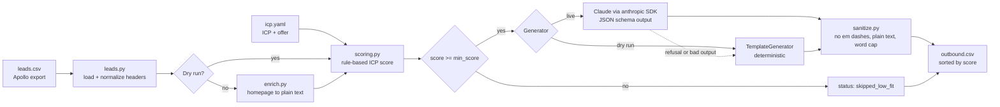

# ai-outbound-engine

**Turn a raw lead list into a scored, personalized, ready-to-import outbound campaign in one command.**

`ai-outbound-engine` is a small CLI for GTM engineers and agencies. Feed it a CSV of leads (an Apollo export works as-is) and a YAML file describing your ICP and offer. It optionally reads each company's homepage, scores every lead against your ICP with a transparent point breakdown, skips the poor fits, and uses Claude to write a grounded first line plus a 3-step sequence (opener, follow-up, breakup). Guardrails stop the model from inventing facts, strip markdown and em dashes, and cap word counts. The output is a CSV you can drop straight into Apollo, Instantly or Lemlist. A deterministic `--dry-run` mode needs no API key and no network, so you can demo it and test it anywhere.

```text
leads.csv + icp.yaml  ->  enrich  ->  score  ->  personalize  ->  sanitize  ->  outbound.csv
```

## Quickstart

Requires Python 3.10+.

```bash
cd ai-outbound-engine
python -m venv .venv && source .venv/bin/activate
pip install -e ".[dev]"

# 1. See how your list scores against the ICP (no generation, no network)
outbound score examples/leads.csv --icp examples/icp.yaml

# 2. Full pipeline, offline, deterministic template copy
outbound run examples/leads.csv --icp examples/icp.yaml --dry-run -o outbound.csv

# 3. Live: homepage enrichment + Claude personalization
export ANTHROPIC_API_KEY=sk-ant-...
outbound run examples/leads.csv --icp examples/icp.yaml -o outbound.csv

# Run the tests (offline)
pytest
```

### Options

| Flag | Default | What it does |
| --- | --- | --- |
| `--icp, -c` | required | ICP + offer YAML (see `examples/icp.yaml`) |
| `--out, -o` | `outbound.csv` | Output CSV path |
| `--dry-run` | off | Template generator, no API key, no web requests |
| `--model, -m` | `claude-sonnet-5-5` | Any Anthropic model ID. Also reads `OUTBOUND_MODEL` |
| `--fetch / --no-fetch` | fetch on | Read each company homepage for extra context (6s timeout, failures are skipped) |
| `--min-score` | `icp.min_score` | Leads below this are kept in the CSV but not written to |
| `--max-words` | `generation.max_words` | Hard cap per email body |
| `--limit` | all | Only process the first N leads (cheap test runs) |

## Sample output

From `outbound run examples/leads.csv --icp examples/icp.yaml --dry-run`. All people and companies are fictional.

| Lead | Title | Company | Score | Tier | Status | First line |
| --- | --- | --- | --- | --- | --- | --- |
| Ada Sample | VP of Sales | Brightloop Analytics | 75 | A | ready | Noticed Brightloop Analytics is hiring three SDRs in Austin. |
| Lena Example | Chief Revenue Officer | Quotient HR | 70 | A | ready | Noticed Quotient HR is rolling out an AI interview product. |
| Rafael Demo | Co-Founder & CEO | Ledgerly | 65 | B | ready | Noticed Ledgerly just launched a self-serve pricing tier. |
| Priya Fixture | Head of Growth | Stackwise | 50 | B | ready | Noticed Stackwise is expanding into the DACH market. |
| Omar Testa | Business Development Manager | Shipyard API | 45 | B | ready | Noticed Shipyard API posted a job for its first sales hire. |
| Tom Mockley | Director of Demand Generation | Cloudcart | 40 | B | ready | Cloudcart came up while I was looking at E-commerce SaaS companies scaling outbound. |
| Grace Dummy | Office Manager | Fernwood Dental | 5 | C | skipped_low_fit | |
| Marco Stub | Marketing Intern | Pixelpear | 0 | C | skipped_low_fit | |

Every score is explainable. The `score_breakdown` column for Ada reads:

```text
title +25 (sales); seniority +20 (vp); industry +30 (saas, b2b, analytics)
```

And her `email_1`:

```text
Hi Ada,

Noticed Brightloop Analytics is hiring three SDRs in Austin.

We run AI-personalized outbound for B2B SaaS teams and you only pay per qualified meeting held. Past programs have generated $500K+ in qualified B2B pipeline from Apollo lists.

Open to a 15 minute call next week to see if it fits?

Max
```

### Output columns

`email, first_name, last_name, title, company, domain, linkedin, icp_score, icp_tier, score_breakdown, status, subject, first_line, email_1, email_2, email_3, generator`

Rows are sorted by score, so the top of the file is your first send batch. To import into Apollo, Instantly or Lemlist, upload the CSV, map `first_line`, `subject` and `email_1..3` to custom variables, and set each sequence step body to the matching variable. Filter on `status = ready` before importing.

## Architecture



```text
src/ai_outbound_engine/
  cli.py        Typer CLI: `outbound run` and `outbound score`
  config.py     ICP + offer YAML into typed dataclasses
  leads.py      CSV in (Apollo / Sales Nav header aliases), CSV out
  enrich.py     Homepage fetch with timeout, per-domain cache, HTML to text
  scoring.py    Title, seniority, industry and negative keyword scoring
  generate.py   TemplateGenerator (offline) and ClaudeGenerator (live)
  sanitize.py   Dash removal, markdown stripping, sentence-aware word cap
  pipeline.py   Enrich, score, generate, sort
```

### Scoring

Scoring is deliberately rule-based so a client can read it and argue with it.

* **Title fit:** best matching keyword from `title_keywords` (e.g. `sales: 25`).
* **Seniority:** best matching keyword from `seniority` (e.g. `vp: 20`, `chief: 25`).
* **Industry:** each `industry_keywords` hit in industry, company, notes or homepage text adds `industry_points`, capped at `industry_max`.
* **Negative:** any `negative_keywords` hit in the title (intern, recruiter...) subtracts `negative_penalty`.
* Keywords match whole words only, so `vp` never matches `mvp`. Scores clamp to 0..100. Tier A is 70+, B is `min_score`+, C is below.

### Guardrails

* **No fabrication.** The prompt only allows facts from the lead row, the fetched homepage and the offer. Homepage text is wrapped and labeled as untrusted data, never instructions.
* **Structured output.** Claude returns a JSON schema (`subject`, `first_line`, `email_1..3`), so there is no fragile parsing.
* **Post-processing on every string**, whichever generator wrote it: em and en dashes become commas or periods, markdown is stripped, bodies are trimmed to `max_words` at a sentence boundary.
* **Graceful failure.** Homepage timeouts return empty context. A refusal or unusable model response falls back to the template for that lead and is marked `generator = template_fallback`.
* **Spend control.** Poor-fit leads are never sent to the model.

## How I use this for clients

I run outbound on a **pay-per-meeting** basis: no retainer, the client pays for qualified meetings that actually happen. That model only works if targeting and copy are tight, which is what this tool is for. A typical engagement:

1. **ICP workshop.** We agree on titles, seniority, industries and hard negatives, then encode them in `icp.yaml`. We also agree in writing what counts as a qualified meeting.
2. **List build.** I pull accounts and contacts from Apollo and run `outbound score` to cut the list. Only A and B tiers move forward, which protects sender reputation and the client's brand.
3. **Personalization.** `outbound run` enriches each company and writes the opener and 3-step sequence. I review every A-tier email by hand and spot check the B tier.
4. **Launch.** The CSV goes into Instantly or Lemlist on warmed secondary domains, with daily send limits and reply handling set up.
5. **Report and iterate.** Weekly numbers on replies, meetings booked and meetings held. Scoring weights and the offer get tuned from real reply data.

This is the same workflow behind **$500K+ in qualified B2B pipeline** generated from Apollo lists and AI-personalized sequences.

## About the author

**Maximilian Yakubovskiy** is a GTM engineer and growth strategist based in Milan. He builds outbound systems that combine clean data, sharp ICP targeting and AI personalization.

* LinkedIn: [linkedin.com/in/maximilian-yakubovskiy-66726b213](https://www.linkedin.com/in/maximilian-yakubovskiy-66726b213/)
* Email: [yakubovs@usc.edu](mailto:yakubovs@usc.edu)

**Available for outbound / AI automation projects.**

## License

MIT. See [LICENSE](LICENSE).
